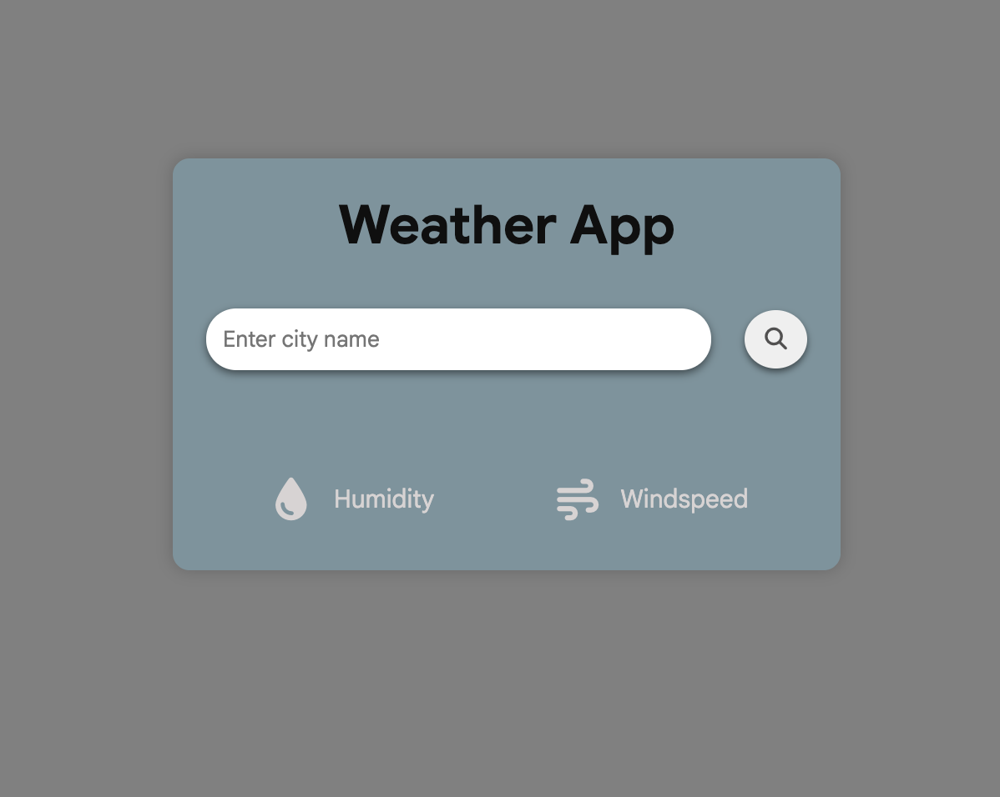
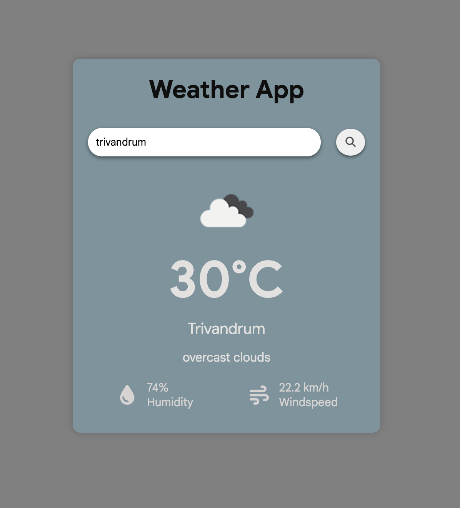
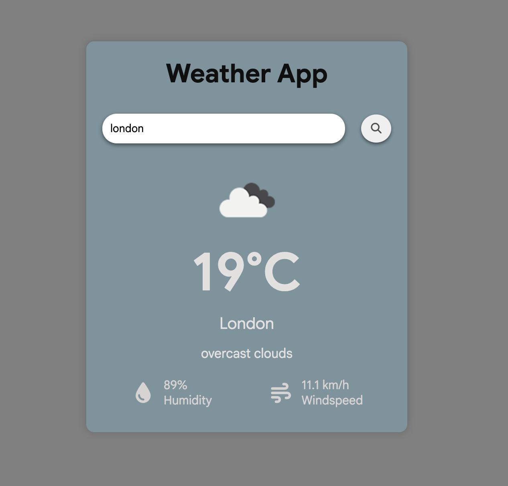

# 🌤️ Weather App

A JavaScript weather application that fetches real-time weather information using the **OpenWeatherMap API**. Users can search for a city and view its current weather conditions through a simple interface.

## 🚀 Live Demo

[View Live Demo](YOUR_GITHUB_PAGES_URL)

## 📸 Preview

## ✨ Features

- Search weather by city name
- Fetch real-time weather data using OpenWeatherMap API
- Display current temperature
- Display weather conditions
- Display location information
- Handle API requests using JavaScript
- Handle invalid city searches and API errors
- Simple and interactive user interface

## 🛠️ Technologies Used

- HTML5
- CSS3
- JavaScript
- OpenWeatherMap API
- Fetch API
- DOM Manipulation

## 📚 What I Learned

Through this project, I practiced:

- Working with third-party APIs
- Using the JavaScript `fetch()` API
- Working with asynchronous JavaScript
- Using `async/await`
- Handling API responses
- Handling errors with `try...catch`
- Working with JSON data
- DOM manipulation
- Updating the UI dynamically
- Using API query parameters
- Managing API configuration

## 🌐 API

This project uses the **OpenWeatherMap API** to retrieve weather information.

[OpenWeatherMap](https://openweathermap.org/)

---

## 📈 Future Improvements

* Add a 5-day weather forecast
* Add weather icons and animations
* Add current location/weather using geolocation
* Add temperature unit conversion
* Improve mobile responsiveness
* Add search suggestions
* Improve loading and error states

---

## 👨‍💻 Author

**Arjun S**

* GitHub: https://github.com/arjunsudheer-tech
* LinkedIn: https://www.linkedin.com/in/arjunsudheer-tech/

---

⭐ If you like this project, consider giving it a star.